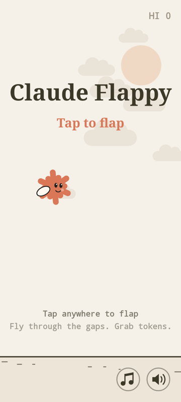
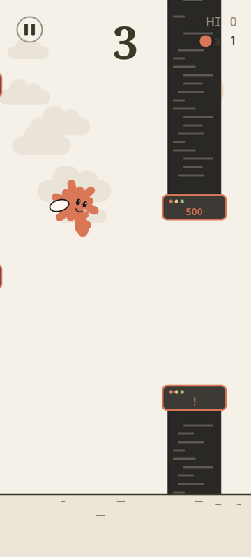
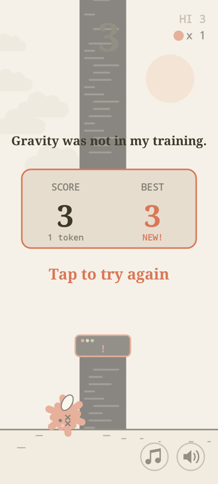
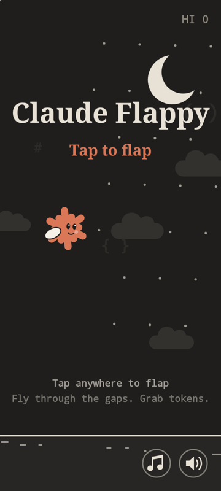
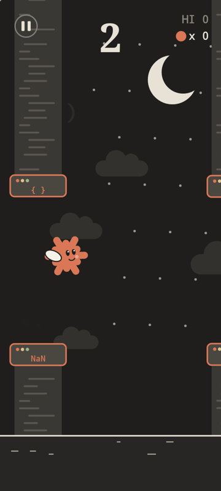

# Claude Flappy

A small one-tap Android game starring Claude's orange spark, now with a wing. Tap to
flap and thread the spark through the gaps between pillars of buggy code (each capped by
a terminal window showing `ERR`, `404`, `NaN` and friends). Every pillar you pass scores
a point, and tokens floating between the pillars are worth a bonus point each. The gaps
narrow as your score climbs, and from 15 points on some of them drift up and down. Day
turns to night every 30 points.

**Dark mode:** the game follows your phone's system theme. With dark mode on, it plays
in the dark palette the whole time; switch the setting while playing and the colors fade
over without interrupting your flight.

| Title | Flying | Game over |
|---|---|---|
|  |  |  |
|  |  | |

**Sound:** soft synth effects for flapping, passing a pillar, collecting tokens (quick
pickups chime higher and higher), milestones every 10 points, crashing and starting a
run, plus a light looping background track that quietens on the game over screen. The
two buttons in the bottom-right of the title, pause and game over screens toggle the
music (♫, or press `N`) and the sound effects (speaker, or `M`); both choices are
remembered. The phone's volume buttons control the game volume. The effects are small
WAV files; the music is synthesized in code when the game starts.

**Full screen:** the game hides the status and navigation bars and draws behind the camera
notch / punch hole, while keeping the score and buttons clear of it.

## Controls

| Action | Touch | Keyboard |
|---|---|---|
| Start / flap | Tap anywhere | Space, ↑, W, Enter |
| Pause / resume | Pause button (top left) | P, Esc |
| Music on / off | ♫ button (menus only) | N |
| Sound effects on / off | Speaker button (menus only) | M |

The game also pauses itself when you leave the app.

## Get the APK

- **Releases (easiest):** open the repo's **Releases** page and download
  `ClaudeFlappy-v<version>.apk` from the latest release, then open it on your phone (allow
  "install unknown apps"). Each release installs over the previous one and keeps your
  high score.
- **Any build:** every push and pull request, on any branch, runs the *Build APK*
  workflow; open the run in the **Actions** tab and download the `claude-flappy-apk`
  artifact (the `test-renders` artifact has screenshots from the automated play test).
- **Build locally:** with the Android SDK installed (or Android Studio), run

  ```sh
  ./gradlew assembleDebug
  # APK: app/build/outputs/apk/debug/app-debug.apk
  adb install app/build/outputs/apk/debug/app-debug.apk
  ```

Or just open the folder in Android Studio and press Run.

### Branches and releases

Work happens on feature branches; each push there runs the tests and builds the APK. When
a push (or merged pull request) to `main` changes `versionName` in `app/build.gradle`, the
workflow publishes a release tagged `v<versionName>` with the APK attached and the commits
since the last release as notes. So to ship a new version, bump `versionCode` and
`versionName` and merge to `main`. Pushes to `main` that don't change the version just
build. All APKs are signed with `app/debug.keystore`, a key generated for this project and
committed so local and CI builds share one signature (fine for sideloading; not meant for
the Play Store).

## Project layout

- `app/src/main/java/com/claudegame/flappy/GameView.java` — the whole game: physics,
  pillar spawning, collisions and Canvas rendering (no image assets).
- `app/src/main/java/com/claudegame/flappy/MainActivity.java` — fullscreen portrait host.
- `app/src/main/res/raw/sfx_*.wav` — the sound effects (synthesized, no third-party audio).
- `app/src/main/java/com/claudegame/flappy/Sfx.java` — plays the effects via SoundPool.
- `app/src/main/java/com/claudegame/flappy/Synth.java` — tiny synthesizer that renders the
  music loop at startup.
- `app/src/main/java/com/claudegame/flappy/Music.java` — streams the gapless music loop.
- `app/src/test/.../GameViewRenderTest.java` — headless Robolectric tests that play the
  game with an autopilot and render frames to `app/build/renders/`
  (`./gradlew testDebugUnitTest`).

Requires Android 8.0 (API 26) or newer.
